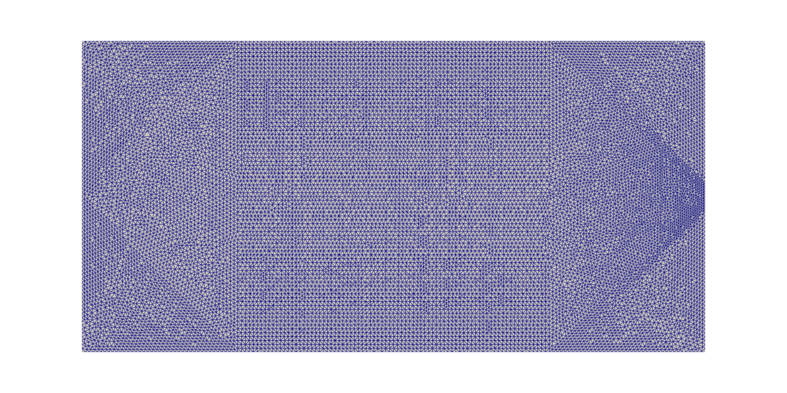

## 1. 必要的 load
~~~freefem
load "distance"
load "iovtk"
load "PETSc"
verbosity = 0;
~~~

## 2. 参数设置
|变量名|作用|
|:---:|:---:|
|Titer|迭代时间步长|
|iterMax|最大迭代步数|
|mu|拉梅常数$\mu$|
|lambda|拉梅常数$\lambda$|
|gamma|界面宽度$\gamma$|
|epsilonFactor|Olsson 界面参数与网格尺寸之比$\epsilon/h_{\max}$|
|weak|弹性方程中非材料区的刚度下限$s$|
|object|输出信息保存文件(.obj)|
|ModelMatLabName|需要使用Matlab处理的数据(.m)|

~~~freefem
real Titer = 0.075;

int iterMax = 300; 

real mu = 8.;	    
real lambda = 1.;
real weak = 1e-4;
real gamma = 0.;
real epsilonReinit = 0.;
real epsilonFactor = 0.5; // P1-stable lower bound; mesh refinement makes the physical interface thinner
real reinitDt = 0.;
int reinitMax = 12;
real reinitTol = 1e-6;

ofstream object("./Output/Main.obj");

string ModelMatLabName = "matlab/Model1_Shape1.m";
~~~

## 3. 函数和微分算子
$$
\rho_0=M_{\gamma}(\phi_0),\qquad
M_{\gamma}(\phi)=\frac{1}{1+\exp(\phi/\gamma)},\qquad M_{\gamma}(0)=0.5.
$$
这正是 Olsson 重初始化的一维稳态剖面。取
`gamma = epsilonReinit` 后，初始剖面与重初始化的目标剖面具有相同厚度；
$0.05\leq\rho\leq0.95$ 的物理厚度约为 $2\ln(19)\epsilon\approx5.89\epsilon$。
这里的 $\phi_0$ 只用于构造一次初值。之后所有方程均只求解 $\rho$，不再恢复或更新 $\phi$。
~~~freefem
// One-time Olsson equilibrium map.  The original sign convention is kept:
// phi0 < 0 is material, phi0 > 0 is void, and MGamma(0) = 0.5.
macro MGamma(phi)
(
    1.0 / (1.0 + exp(phi / gamma))
)//
~~~

$$
\begin{align*}
\epsilon(u):\epsilon(v) &= \left[\partial_x u_x, \partial_y u_y, \frac{\partial_y u_x + \partial_x u_y}{\sqrt{2}}\right] \cdot \left[\partial_x v_x, \partial_y v_y, \frac{\partial_y v_x + \partial_x v_y}{\sqrt{2}}\right] \\
\nabla u &= [\partial_x u, \partial_y u] \\
Du &= [\nabla u_x, \nabla u_y] \\
\texttt{div} \ u &= \partial_x u_x + \partial_y u_y
\end{align*}
$$

~~~freefem
macro epsilon(ux, uy) [dx(ux), dy(uy), (dy(ux)+dx(uy))/sqrt(2)] //
macro grad(u) [dx(u), dy(u)] //
macro Grad(ux, uy) [dx(ux), dy(ux), dx(uy), dy(uy)] //
macro div(ux, uy) ( dx(ux) + dy(uy) ) //
~~~

## 4. 二维网格和有限元空间
|变量名|作用|
|:---:|:---:|
|Uh|位移场（P1 向量元）|
|Thetah|下降方向场（P1 向量元）|
|P1h|Lagrange线性元|
|Phih|迭代变量$\rho$所在的连续 P1 有限元空间|

本版将位移场和下降方向场全部改为 P1 向量元。当前材料参数 \(\lambda=1,\mu=8\)，体积泊松比远小于 0.5，P1 位移元不会出现体积锁定。P1 位移场的应变为分片常数，下降方向场仍通过 \(H^1\) 椭圆正则化求得。密度输运和 Olsson 重初始化都在同一个连续 P1 空间中进行。
~~~freefem
// first label meanings: 1 = Neumann, 2 = Dirichlet, 3 = Force(Non Neumann)
// second label meanings: 1 = (V_x = 0), 2 = (V_y = 0)
border bdrightN1(t = -0.5, -0.05)  { x=1;  y=t; label=11; }; // right
border bdrightNN(t = -0.05, 0.05)  { x=1;  y=t; label=3; }; // right
border bdrightN2(t = 0.05, 0.5)    { x=1;  y=t; label=11; }; // right
border bdleftD(t = 0.5, -0.5)	   { x=-1; y=t; label=2; }; // left
border bdupN(t = 1, -1)		       { x=t;  y=0.5; label=12; };   // upper
border bdbottomN(t = -1, 1)		   { x=t;  y=-0.5; label=12; };  // lower

int n = 8;
mesh Th= buildmesh ( bdrightN1(9*n) + bdrightNN(3*n) + bdrightN2(9*n)
                     + bdleftD(20*n)
                     + bdupN(40*n)
                     + bdbottomN(40*n) );

fespace Uh(Th, [P1, P1]);      
fespace Thetah(Th, [P1, P1]);   
fespace P1h(Th, P1); 
fespace Phih(Th, P1);
fespace Normalh(Th, [P1, P1]);

P1h h1 = hTriangle;
real hmax = h1[].max; 
real hmin = h1[].min;
// Olsson et al. derive epsilon >= hK/2 as a sufficient local P1 bound.
// Use epsilon = hmax/2 and refine the mesh to make the physical interface
// thinner without entering the oscillatory under-resolved regime.
epsilonReinit = epsilonFactor * hmax;
// The initial map is the steady profile of the same reinitialization PDE.
gamma = epsilonReinit;
reinitDt = epsilonReinit;
object << "maximal size of a mesh triangle h = " << hmax << endl;
object << "minimal size of a mesh triangle h = " << hmin << endl;
object << "conservative reinitialization epsilon = " << epsilonReinit << endl;
object << "epsilon/hmax factor = " << epsilonFactor << endl;
object << "initial MGamma gamma = " << gamma << endl;
~~~
| 网格 |
|:-----:|
||

## 5. 初始形状和 PDE 求解
### 5.1 初始形状设置
先将区域分成正负值，构造func变量phi0  
再通过内置 `distance` 函数仅构造一次带符号距离 $\phi_0$，并令
$\rho_0=M_\gamma(\phi_0)$。原约定保持不变：$\phi_0<0$ 为材料，
$\rho_0>0.5$ 为材料。进入迭代后不再保存、恢复或求解 $\phi$。
~~~freefem
macro R1()
(
    0.2 - sqrt((abs(x))^2 + (abs(y) - 0.5)^2)
) //
macro R2()
(
    0.2 - sqrt((abs(x) - 0.6)^2 + (abs(y) - 0.5)^2)
) //
macro R3()
(
    0.1 - sqrt((abs(x) - 0.3)^2 + (abs(y) - 0.25)^2)
) //
macro R4()
(
    0.1 - sqrt((abs(x) - 1)^2 + (abs(y) - 0.25)^2)
) //
macro R5()
(
    0.2 - sqrt((abs(x))^2 + (abs(y))^2)
) //
macro R6()
(
    0.2 - sqrt((abs(x) - 0.6)^2 + (abs(y))^2)
) //
func phi0 = (R1 >= 0) * R1 
            + (R2 >= 0) * R2
            + (R3 >= 0) * R3
            + (R4 >= 0) * R4
            + (R5 >= 0) * R5
            + (R6 >= 0) * R6
            + (R1 < 0 && R2 < 0 && R3 < 0 && R4 < 0 && R5 < 0 && R6 < 0) * (max(R1,max(R2,max(R3,max(R4,max(R5,R6))))));

P1h phi0Distance;
distance(Th, phi0, phi0Distance[]);

Phih Rho;
// The only use of phi0: initialize rho.  All later PDEs use rho only.
Rho = MGamma(phi0Distance);
plot(Rho, fill = 1, value = 1, cmm = "Rho_0");
savevtk("./figure/Rho_0.vtu", Th, Rho);
~~~
| 初始形状 |
|:-----:|
||

### 5.2 位移计算
|变量名|作用|
|:---:|:---:|
|[ux, uy]|位移|
|[vx, vy]|测试函数|
|Elasticity|线弹性刚度矩阵|
|ElasticityRHS|线弹性右端项|
|ElasticityPDE|求解线弹性方程|
|Elasticityb|右端项向量|
|A|线弹性系统矩阵|

在设计区域 $D$ 中，位移 $u$ 满足线弹性变分形式：
$$
\begin{align*}
\int_D \rho_{\texttt{weak}} A \varepsilon(u):\varepsilon(v) dx = \int_D f \cdot u dx + \int_{\partial D_N} g \cdot u ds, \quad \forall v \in [H_{\partial D_D}^1(D)]^2
\end{align*}
$$
对应线性系统：
$$
Ax = b
$$
$A$ 是由 $2\mu\rho\,\varepsilon(u):\varepsilon(v)+\lambda\rho\,\operatorname{div}u\operatorname{div}v$ 形成的线弹性刚度矩阵，$b$ 是边界力右端项向量。
~~~freefem
Uh [ux, uy], [vx, vy];

func gx = 0.;
func gy = -5.;

varf Elasticity([ux, uy], [vx, vy]) =
int2d(Th)(
        2 * mu * max(weak, Rho) * ( epsilon(ux, uy)' * epsilon(vx, vy) )
        + lambda * max(weak, Rho) * div(ux, uy) * div(vx, vy)
        )
+ on(2, ux = 0, uy = 0);

varf ElasticityRHS([ux, uy], [vx, vy]) =
int1d(Th, 3)( gx * vx + gy * vy )
+ on(2, ux = 0, uy = 0);

real[int] Elasticityb = ElasticityRHS(0, Uh);

macro ElasticityPDE(ux, uy, Rho)
{
    matrix Am = Elasticity(Uh, Uh);

    Mat A(Am);
    set(A, sparams = "-pc_type lu");

    real[int] sol = A^-1 * Elasticityb;
    ux[] = sol;
}//
~~~

### 5.3 下降方向计算
考虑 compliance 目标泛函。初始化之后设计变量就是 $\rho$：
$$
J(\Omega):= \int_D \rho A \epsilon(u):\epsilon(u) dx
$$
其中形状$\Omega = \lbrace \rho > 0.5 \rbrace$，这与初始约定
$\lbrace\phi_0<0\rbrace$ 完全一致。
对应的形状导数为：
$$
dJ(\Omega;\theta) = \int_D A\epsilon(u):\epsilon(u) \theta \cdot \nabla \rho dx
$$
在设计区域 $D$ 中，下降方向 $\theta$ 通过带体积约束的椭圆方程计算：
$$
\begin{align*}
\begin{cases}
\int_D \nabla \theta : \nabla w dx + \int_D  \theta \cdot w dx + \int_D p \ w \cdot \nabla \rho dx  = -dJ(\Omega;w) & \forall w \in [H_0^1(D)]^2 \\
\int_D q \ \theta \cdot \nabla \rho dx = 0 & \forall q \in \mathbb{R}
\end{cases}
\end{align*}
$$
对应的线性系统：
$$
\begin{bmatrix}
A & c_{\rho} \\
c_{\rho}^T & 0
\end{bmatrix} 
\begin{pmatrix}
V_{\rho} \\
p
\end{pmatrix} =
\begin{pmatrix}
b_{\rho} \\
0
\end{pmatrix} 
$$

~~~freefem
Thetah [thetax, thetay], [Wx, Wy];

varf VelocityA([thetax, thetay], [Wx, Wy]) =
int2d(Th)( 
            Grad(thetax, thetay)' * Grad(Wx, Wy)
            + ([thetax, thetay]' * [Wx, Wy])
        )
+ on(3, thetax = 0, thetay = 0)
+ on(11, 2, thetax = 0)
+ on(12, thetay = 0);
matrix A2m = VelocityA(Thetah, Thetah);

macro VelocityPDE(thetax, thetay, ux, uy, Rho)
{
    varf VelocitycRho([thetax, thetay], [Wx, Wy]) = 
    int2d(Th) ([Wx, Wy]' * grad(Rho))
    + on(3, thetax = 0, thetay = 0)
    + on(11, 2, thetax = 0)
    + on(12, thetay = 0);

    varf VelocitybRho([thetax, thetay], [Wx, Wy]) =
    - int2d(Th)( 
                 (2 * mu *  epsilon(ux, uy)' * epsilon(ux, uy) 
                   + lambda * div(ux, uy) * div(ux, uy) ) 
                 *([Wx, Wy]' * grad(Rho))
               )
    + on(3, thetax = 0, thetay = 0)
    + on(11, 2, thetax = 0)
    + on(12, thetay = 0);

    real[int] cRho = VelocitycRho(0, Thetah);
    real[int] bRho = VelocitybRho(0, Thetah);

    matrix LHSm = [[A2m, cRho], [cRho', 0]];
    real[int] RHS = [bRho, 0];
    set(LHSm, solver = CG, eps = 1e-8);
    Mat LHS(LHSm);
    set(LHS, sparams = "-pc_type lu");

    real[int] sol(RHS.n);
    sol = LHS^-1 * RHS;
    thetax[] = sol(0:sol.n-1);
}//
~~~
计算目标泛函 $J(\Omega)$ 和当前弥散材料体积：
~~~freefem
macro GetCompliance(ux, uy, Rho)
(
    int2d(Th)(
                2 * mu * max(weak, Rho) * ( epsilon(ux, uy)' * epsilon(ux, uy) )
                + lambda * max(weak, Rho) * div(ux, uy) * div(ux, uy)
            )
) //

macro GetVol(Rho)
(
    int2d(Th) (Rho)
)//

~~~

### 5.4 形状更新
采用连续 P1 SUPG 方法求解密度场，输运微分方程保持为：
$$
\partial_t \rho_h + \theta \cdot \nabla \rho_h = 0
$$
在每次形状更新中取 $dt=Tsum/5$。为抑制纯对流振荡，加入基于输运残差的
SUPG 稳定项；同时通过一个全局拉格朗日乘子逐子步强制
$\int_D\rho_h^{n+1}dx=\int_D\rho_h^n dx$。离散问题为：求
$(\rho_h^{n+1},\lambda_h)\in P_1\times\mathbb{R}$，使
$$
\begin{align*}
&\left(\frac{\rho_h^{n+1}-\rho_h^n}{dt}
 +\theta\cdot\nabla\rho_h^{n+1},v_h\right)
 +\sum_K\left(\tau_K\left[\frac{\rho_h^{n+1}-\rho_h^n}{dt}
 +\theta\cdot\nabla\rho_h^{n+1}\right],
 \theta\cdot\nabla v_h\right)_K
 +\lambda_h(1,v_h)=0,\\
&\int_D\rho_h^{n+1}dx=\int_D\rho_h^n dx.
\end{align*}
$$
SUPG 参数取
$\tau_K=((2/dt)^2+(2|\theta|/h_K)^2)^{-1/2}$。
稳定项在常数测试函数下为零，而第二个方程直接保证离散质量守恒。
~~~freefem
macro StableConservativeP1Transport(rhoOutput, rhoInput, thetax, thetay, Tsum)
{
    real dt = Tsum / 5.;
    Phih u, v;
    P1h tauSUPG = 1.0 / sqrt(
          (2.0 / dt)^2
        + (2.0 * sqrt(thetax^2 + thetay^2 + 1e-16) / hTriangle)^2
        + 1e-16
    );

    varf TransportA(u, v) = int2d(Th)(
          u * v / dt
        + ([thetax, thetay]' * grad(u)) * v
        + tauSUPG
          * (u / dt + [thetax, thetay]' * grad(u))
          * ([thetax, thetay]' * grad(v))
    );
    varf TransportB(u, v) = int2d(Th)(
          u * v / dt
        + tauSUPG * (u / dt)
          * ([thetax, thetay]' * grad(v))
    );
    varf MeanVector(u, v) = int2d(Th)(v);

    matrix Am = TransportA(Phih, Phih);
    matrix Bm = TransportB(Phih, Phih);
    real[int] c = MeanVector(0, Phih);
    matrix Km = [[Am, c], [c', 0.]];
    set(Km, solver = sparsesolver);

    for (int transportStep = 0; transportStep < 5; transportStep++)
    {
        real targetMass = int2d(Th)(rhoInput);
        real[int] scalarRHS = Bm * rhoInput[];
        real[int] blockRHS = [scalarRHS, targetMass];
        real[int] solution = Km^-1 * blockRHS;
        rhoOutput[] = solution(0:Phih.ndof-1);
        rhoInput = rhoOutput;
    }
}//
~~~

## 6. 程序主要部分
### 6.1 第 i 步迭代信息输出
~~~freefem
macro OutPutData(i, compliance, vol, obj)
{
    if (i == 0)
    {
        obj << "Initial Condition: " << endl;
        obj << "Initial compliance = " << compliance[i] << endl;
        obj << "Initial Vol = " << vol[i] << endl;
    }
    else
    {
        obj << i << "-th iteration: " << endl;
        obj << "Compliance = " << compliance[i] << ";   diff = " << compliance[i] - compliance[i-1] << endl;
        obj << "Vol = " << vol[i] << ";   diff = " << vol[i] - vol[0] << endl;
    }
    obj.flush;
}//
~~~
### 6.2 连续 P1 守恒有限元重初始化

输运和重初始化现在使用同一个连续 P1 空间，因此不再进行 P1dc 与 P1 之间的投影。
重初始化不调用 `distance`，直接对 $\rho\in[0,1]$ 求解 Olsson 伪时间方程：
$$
\partial_s \rho+\nabla\cdot\left(\rho(1-\rho)n_h\right)
=\epsilon\nabla\cdot\left((\nabla \rho\cdot n_h)n_h\right).
$$
其中 $n_h$ 由输运后的 $\rho$ 作有限元 $L^2$ 投影得到，并在整个伪时间迭代中冻结。
压缩与扩散均为守恒通量，因此在零通量边界下保持 $\int_D \rho\,dx$ 不变。
若 SUPG 输运或连续 P1 重初始化产生微小越界，则通过全局质量守恒的有界校正恢复
$0\le U\le1$，校正前后保持 $\int_DUdx$ 不变。

~~~freefem
macro ConservativeReinitRho(rhoInput)
{
    P1h Uc, Uold, Unext, Ubounded, Udiff;
    Normalh [nx, ny], [tx, ty];
    real reinitResidual = 0.;
    real targetMass = 0.;
    real lowerShift = 0.;
    real upperShift = 0.;
    real shift = 0.;
    real boundedMass = 0.;
    int reinitIter = 0;
    int reinitSteps = 0;
    int correctionIter = 0;

    Uc = rhoInput;
    targetMass = int2d(Th)(Uc);

    if (Uc[].min < 0. || Uc[].max > 1.)
    {
        lowerShift = -2. - Uc[].max;
        upperShift =  2. - Uc[].min;
        for (correctionIter = 0; correctionIter < 50; correctionIter++)
        {
            shift = 0.5 * (lowerShift + upperShift);
            Ubounded = min(1., max(0., Uc + shift));
            boundedMass = int2d(Th)(Ubounded);
            if (boundedMass < targetMass) lowerShift = shift;
            else upperShift = shift;
        }
        Uc = Ubounded;
    }

    solve ProjectNormal([nx, ny], [tx, ty]) =
        int2d(Th)(nx * tx + ny * ty)
      - int2d(Th)(
            dx(Uc) / sqrt(dx(Uc)^2 + dy(Uc)^2 + 1e-16) * tx
          + dy(Uc) / sqrt(dx(Uc)^2 + dy(Uc)^2 + 1e-16) * ty
        );

    for (reinitIter = 0; reinitIter < reinitMax; reinitIter++)
    {
        Uold = Uc;
        varf ReinitA(Unext, v) =
            int2d(Th)(
                Unext * v / reinitDt
              - (dx(v) * nx + dy(v) * ny) * Unext * (0.5 - Uc)
              + 0.5 * epsilonReinit
                * (dx(v) * nx + dy(v) * ny)
                * (dx(Unext) * nx + dy(Unext) * ny)
            );
        varf ReinitRHS(Unext, v) =
            int2d(Th)(
                Uc * v / reinitDt
              + 0.5 * (dx(v) * nx + dy(v) * ny) * Uc
              - 0.5 * epsilonReinit
                * (dx(v) * nx + dy(v) * ny)
                * (dx(Uc) * nx + dy(Uc) * ny)
            );
        matrix Am = ReinitA(P1h, P1h);
        real[int] reinitRHS = ReinitRHS(0, P1h);
        Unext[] = Am^-1 * reinitRHS;
        if (Unext[].min < 0. || Unext[].max > 1.)
        {
            lowerShift = -2. - Unext[].max;
            upperShift =  2. - Unext[].min;
            for (correctionIter = 0; correctionIter < 50; correctionIter++)
            {
                shift = 0.5 * (lowerShift + upperShift);
                Ubounded = min(1., max(0., Unext + shift));
                boundedMass = int2d(Th)(Ubounded);
                if (boundedMass < targetMass) lowerShift = shift;
                else upperShift = shift;
            }
            Uc = Ubounded;
        }
        else Uc = Unext;
        Udiff = Uc - Uold;
        reinitResidual = sqrt(int2d(Th)(Udiff^2)) / reinitDt;
        reinitSteps++;
        if (reinitResidual < reinitTol) break;
    }

    rhoInput = Uc;
    cout << "Conservative reinit steps = " << reinitSteps
         << "; residual = " << reinitResidual << endl;
}//
~~~
### 6.3 第 0 步：先计算位移和下降方向

~~~freefem
Phih rhotest;
real[int] compliance(iterMax + 1);
real[int] Vol(iterMax + 1);
real domainArea = int2d(Th)(1.0);

int iter = 0;
cout << "Yes1!" << endl; 
ElasticityPDE(ux, uy, Rho);  
cout << "Yes2!" << endl; 
VelocityPDE(thetax, thetay, ux, uy, Rho);

compliance[iter] = GetCompliance(ux, uy, Rho);
Vol[iter] = GetVol(Rho);
OutPutData(iter, compliance, Vol, object);
~~~
### 6.4 迭代求解

每 10 步额外输出一次紧凑的 `[Rho monitor]`，包括 `Rho` 的最小值、最大值、面积加权平均值和当前体积，便于观察界面是否清晰、质量是否守恒。
~~~freefem
while (iter < iterMax)
{
    cout << "Iter = " << iter << endl;
    object << endl;
    object << "Iter = " << iter << endl;

    // Continuous-P1 SUPG transport with an exact global mass constraint.
    rhotest = Rho;
    real volumeBeforeTransport = GetVol(rhotest);
    StableConservativeP1Transport(Rho, rhotest, thetax, thetay, Titer);

    // Olsson conservative finite-element reinitialization after every update.
    // phi0 is not used or reconstructed here.
    real volumeAfterTransport = GetVol(Rho);
    object << "Transport volume change = "
           << volumeAfterTransport - volumeBeforeTransport << endl;
    object << "Rho range after transport = ["
           << Rho[].min << ", " << Rho[].max << "]" << endl;
    ConservativeReinitRho(Rho);
    real volumeAfterReinit = GetVol(Rho);
    object << "Volume after transport = " << volumeAfterTransport << endl;
    object << "Reinitialization volume change = "
           << volumeAfterReinit - volumeAfterTransport << endl;
    object << "Rho range after reinitialization = ["
           << Rho[].min << ", " << Rho[].max << "]" << endl;
    cout << "Conservative Rho reinitialization End!" << endl;

    ElasticityPDE(ux, uy, Rho);
    iter++;
    compliance[iter] = GetCompliance(ux, uy, Rho);
    Vol[iter] = GetVol(Rho); 

    if (iter % 10 == 0)
    {
        real rhoMin = Rho[].min;
        real rhoMax = Rho[].max;
        real rhoMean = int2d(Th)(Rho) / domainArea;
        cout << "[Rho monitor] iter=" << iter
             << " min=" << rhoMin
             << " max=" << rhoMax
             << " mean=" << rhoMean
             << " vol=" << Vol[iter] << endl;
        object << "[Rho monitor] iter=" << iter
               << " min=" << rhoMin
               << " max=" << rhoMax
               << " mean=" << rhoMean
               << " vol=" << Vol[iter] << endl;
    }

            
    object << "Titer = " << Titer << endl;

    OutPutData(iter, compliance, Vol, object);

    // The numerical solve still executes all 300 iterations.  Saving every
    // ten iterations only avoids producing hundreds of unnecessary VTK files.
    if (iter % 10 == 0 || iter == iterMax)
    {
        plot(Rho, fill = 1, value = 1, cmm = "Rho_"+iter);
        string filename = "./figure/Rho_"+iter+".vtu";
        savevtk(filename, Th, Rho);
    }

    VelocityPDE(thetax, thetay, ux, uy, Rho);
}
~~~

### 6.5 compliance 信息和体积信息输出（输出为 Matlab 文件）
~~~freefem
ofstream OutMatlab(ModelMatLabName);
OutMatlab << "Num = " << iter + 1 << endl;
for (int i = 0; i <= iter; i++)
{
    OutMatlab << "Volume(" << i+1 << ") = " << Vol[i] << "; ";
    OutMatlab << "compliance(" << i+1 << ") = " << compliance[i] << ";"<<endl;
}
~~~

## 7. 实验结果
### 7.1 中间形状展示
|| 形状 |
|:----:|:-----:|
|$\rho_0$||
|$\rho_{20}$||
|$\rho_{60}$||
|$\rho_{120}$||
|$\rho_{200}$||
|$\rho_{\texttt{final}}$||

### 7.2 compliance 变化和体积变化图像
||图像|
|:----:|:-----:|
|compliance图像||
|体积图像||

