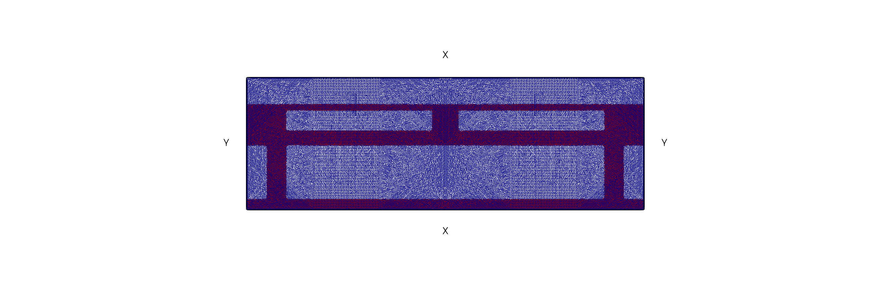

## 1. 必要的 load
本程序只使用 FreeFEM 的顺序 MUMPS 直接解法。线弹性方程、速度场方程以及 DG 更新中的线性系统均通过 `load "MUMPS_seq"` 后的 `sparsesolver` 求解，不再使用 PETSc 的 `Mat` 与 `sparams` 设置。

~~~freefem
load "TetGen"
load "gmsh"
load "distance"
load "iovtk"
load "MUMPS_seq"
verbosity = 0;
~~~

## 2. 参数设置
|变量名|作用|
|:---:|:---:|
|Titer|迭代时间步长|
|iterMax|最大迭代步数|
|mu|拉梅常数$\mu$|
|lambda|拉梅常数$\lambda$|
|gamma|界面宽度$\gamma$|
|weak|非材料区域密度$s$|
|object|输出信息保存文件(.obj)|
|ModelMatLabName|需要使用Matlab处理的数据(.m)|

~~~freefem
real Titer = 0.008;

int iterMax = 1400; 

real mu = 8.;	    
real lambda = 1.;
real weak = 1e-4;
real gamma = 0.002;

ofstream object("./Output/Main.obj");

string ModelMatLabName = "matlab/Model4_Shape1.m";
~~~

## 3. 函数和微分算子
$$
H_{\gamma,s} = (1-s)H_{\gamma}+s
$$
$$
H_{\gamma}(x) = 
\begin{cases}
	0, & \phi > \gamma, \\
    \frac{1}{2} - \frac{\phi}{\gamma} + \frac{\phi^2}{2\gamma^2}, & \phi \in (0, \gamma], \\
	\frac{1}{2} - \frac{\phi}{\gamma} - \frac{\phi^2}{2\gamma^2}, & \phi \in [-\gamma, 0], \\  
	1, & \phi < -\gamma.
\end{cases}
$$
~~~freefem
macro HeaviSide(phi)
(
    (phi > gamma) * weak + 
    (0 < phi && phi <= gamma) *
    ( (1-weak) * (0.5-phi/gamma+0.5*phi^2/gamma^2) + weak) +
    (-gamma <= phi && phi <= 0) * 
    ( (1-weak) * (0.5-phi/gamma-0.5*phi^2/gamma^2) + weak) + 
    (phi < -gamma) * 1.0
)//
~~~

指标函数$sign(x)$
~~~freefem
macro sign(x)
(
    (x >= 0) * 1. + (x < 0) * (-1)
)//
~~~

$$
\begin{align*}
\epsilon(u):\epsilon(v) &= \left[\partial_x u_x, \partial_y u_y, \frac{\partial_y u_x + \partial_x u_y}{\sqrt{2}}\right] \cdot \left[\partial_x v_x, \partial_y v_y, \frac{\partial_y v_x + \partial_x v_y}{\sqrt{2}}\right] \\
\nabla u &= [\partial_x u, \partial_y u] \\
Du &= [\nabla u_x, \nabla u_y] \\
\texttt{div} \ u &= \partial_x u_x + \partial_y u_y
\end{align*}
$$

~~~freefem
macro epsilon(ux, uy) [dx(ux), dy(uy), (dy(ux)+dx(uy))/sqrt(2)] //
macro grad(u) [dx(u), dy(u)] //
macro Grad(ux, uy) [dx(ux), dy(ux), dx(uy), dy(uy)] //
macro div(ux, uy) ( dx(ux) + dy(uy) ) //
~~~

## 4. 二维网格和有限元空间
这里采用图 5-2 桥梁设计的缩放模型，矩形设计区域为 $D=[-1.5,1.5]\times[0,1]$，高为 $1$、底为 $3$。由原模型高度 $200$、宽度 $600$ 缩放得到 $a=0.15$、$c=0.45$、$h=0.05$。中间窄带严格取为 $y\in[0.50,0.55]=[1-c-h,1-c]$，外力作为该窄带上的体积力均匀施加；左右侧白色小圆圈用窄带左右下角向上高度 $0.01$ 的小竖线段（$y\in[0.50,0.51]$）近似，下侧黑色粗线用底边左右两端长度为 $a$ 的线段近似，这些支承边界均施加齐次 Dirichlet 条件。

速度场边界仍按照几何边界分类：在窄带左右侧 $x=\pm1.5,\ y\in[0.50,0.55]$ 和底部支承段上令 $\theta_x=\theta_y=0$；在左右边界其余部分令 $\theta_x=0$；在上下边界其余部分令 $\theta_y=0$。窄带位于初始完整材料区域内，但迭代过程中不再通过密度掩码额外强制为材料。外力作为该窄带区域上的体积力 $f=(0,-10)$ 施加。

为避免非结构化三角剖分破坏桥梁问题的左右对称性，网格只在左半区域 $[-1.5,0]\times[0,1]$ 上生成，再关于 $x=0$ 镜像得到右半网格。拼接后删除对称轴上的临时内部边界，因此每个节点、三角形和边界线段均具有几何及拓扑结构完全一致的镜像对应项。

|变量名|作用|
|:---:|:---:|
|Uh|位移场所在的向量 Lagrange 线性元空间 $[P_1,P_1]$|
|Thetah|速度场所在的向量 Lagrange 线性元空间 $[P_1,P_1]$|
|P1h|连续线性元空间，用于距离函数和辅助变量|
|Phih|间断线性元空间，用于 $\phi$ 和 $\rho$ 的 DG 更新|
|labLR|左右边界，速度场满足 $\theta_x=0$|
|labTB|上下边界中除支承小线段外的部分，速度场满足 $\theta_y=0$|
|labSuppSideL/labSuppSideR|窄带左右边界下侧长度 $0.01$ 的近似支承段，线弹性位移满足 $u_x=u_y=0$|
|labThetaBandSideL/labThetaBandSideR|窄带左右边界其余部分，仅用于速度场满足 $\theta_x=\theta_y=0$|
|labSuppBase|底边左右端黑色粗线支承段，线弹性位移满足 $u_x=u_y=0$|
|labSym|构造半区网格时对称轴 $x=0$ 的临时标签；左右网格拼接后删除|

~~~freefem
int labLR = 11;
int labTB = 12;
int labSuppSideL = 22;
int labSuppSideR = 222;
int labSuppBase = 33;
int labThetaBandSideL = 44;
int labThetaBandSideR = 444;
int labSym = 999;

real bridgeHalfL = 1.5;
real bridgeH = 1.0;
real bridgeA = 0.15;
real bridgeC = 0.45;
real bridgeh = 0.05;
real bridgeDir = 0.01;
real meshH = 0.01;
real ySupp0 = bridgeH - bridgeC - bridgeh; // 0.50: lower edge of load band
real ySupp1 = bridgeH - bridgeC;           // 0.55: upper edge of load band
real yLoad = 0.5 * (ySupp0 + ySupp1);      // 0.525: band center
real sideT0 = 0.;
real sideT1 = 50.;
real sideT2 = 51.;
real sideT3 = 55.;
real sideT5 = 100.;

// sideY keeps about 0.01 spacing on the whole side boundary while preserving
// the exact strip and support breakpoints ySupp0, ySupp0 + 0.01, and ySupp1.
macro sideY(tt) (
    (tt <= sideT1) * (ySupp0 / sideT1 * tt)
  + (sideT1 < tt && tt <= sideT2) * (ySupp0 + bridgeDir * (tt - sideT1))
  + (sideT2 < tt && tt <= sideT3) * (ySupp0 + bridgeDir + (ySupp1 - ySupp0 - bridgeDir) / (sideT3 - sideT2) * (tt - sideT2))
  + (sideT3 < tt) * (ySupp1 + (bridgeH - ySupp1) / (sideT5 - sideT3) * (tt - sideT3))
) //

// Build only the left half and reflect it about x=0. This guarantees that
// every triangle and every boundary segment has an exact mirrored partner.
// The temporary x=0 boundary is removed after the two halves are joined.
border halfBottom(t = -bridgeHalfL, 0.)
{
    x = t;
    y = 0;
    label = (t <= -bridgeHalfL + bridgeA ? labSuppBase : labTB);
};
border halfAxis(t = 0., bridgeH)
{
    x = 0.;
    y = t;
    label = labSym;
};
border halfTop(t = 0., -bridgeHalfL)
{
    x = t;
    y = bridgeH;
    label = labTB;
};
border halfLeft(t = sideT5, sideT0)
{
    x = -bridgeHalfL;
    y = sideY(t);
    label = (t >= sideT1 && t <= sideT2 ? labSuppSideL :
            (t > sideT2 && t <= sideT3 ? labThetaBandSideL : labLR));
};

mesh ThLeft = buildmesh(
      halfBottom(150)
    + halfAxis(100)
    + halfTop(150)
    + halfLeft(100)
);

mesh ThRight = movemesh(ThLeft, [-x, y]);
int[int] mirrorLabels = [
    labSuppSideL, labSuppSideR,
    labThetaBandSideL, labThetaBandSideR
];
ThRight = change(ThRight, refe = mirrorLabels);

mesh Th = ThLeft + ThRight;
Th = change(Th, rmInternalEdges = true);

savevtk("Th2_1.vtu", Th);

fespace Uh(Th, [P1, P1]);
fespace Thetah(Th, [P1, P1]);
fespace P1h(Th, P1);
fespace Phih(Th, P1dc);

P1h h1 = hTriangle;
real hmax = h1[].max;
real hmin = h1[].min;
object << "maximal size of a mesh triangle h = " << hmax << endl;
object << "minimal size of a mesh triangle h = " << hmin << endl;

int Nu = Uh.ndof;
int Ntheta = Thetah.ndof;
~~~
| 网格 |
|:-----:|
||

## 5. 初始形状和 PDE 求解
### 5.1 初始形状设置
初始材料取整个矩形 $[-1.5,1.5]\times[0,0.80]$，并挖去上下两组孔洞。下部在 $y\in[0,0.5]$ 内挖三个高度均为 $0.405$ 的矩形孔，即
$$
[-1.50,-1.35]\times[0.08,0.485],\qquad
[-1.20,1.20]\times[0.08,0.485],\qquad
[1.35,1.50]\times[0.08,0.485].
$$
三个矩形孔下方均保留厚度为 $0.08$ 的连续材料层。孔之间留下两条宽 $0.15$ 的竖向材料带，分别为 $x\in[-1.35,-1.20]$ 和 $x\in[1.20,1.35]$；其外侧边界正好位于设计区域底边左右支承边界的内端 $x=\pm1.35$。矩形孔上方仍完整保留窄带 $y\in[0.50,0.55]$。

上部在 $y\in[0.60,0.75]$ 内挖两个左右对称的矩形孔，即
$$
[-1.20,-0.10]\times[0.60,0.75],\qquad
[0.10,1.20]\times[0.60,0.75].
$$
两个孔的水平长度均为 $1.10$、竖向高度均为 $0.15$，中间保留宽 $0.20$ 的竖向材料隔离带，最外侧各保留宽 $0.30$ 的材料区域；上下两组矩形孔均关于 $x=0$ 严格对称。

忽略界面正则化造成的微小差异，初始材料面积为
$$
3\times0.80-(0.15+2.40+0.15)\times0.405
-2\times1.10\times0.15=0.9765,
$$
即初始材料面积为 $0.9765$，占整个设计区域面积 $3$ 的约 $32.55\%$。

先构造初始符号函数 `phi0`，其中 $\phi>0$ 表示孔洞或非材料区域，$\phi<0$ 表示材料区域。随后通过 `distance` 重新初始化为距离函数，并将重初始化结果与其关于 $x=0$ 的镜像取平均，以消除距离算法造成的微小非对称误差，再转换到 DG 空间中。设计密度取 $\rho_D=H_{\gamma,s}(\phi)$；窄带 $B=\{0.50\le y\le0.55\}$ 作为非设计实体域，弹性方程使用物理密度 $\rho_{\mathrm{phys}}=\chi_B+(1-\chi_B)\rho_D$。
~~~freefem
// Start from 0 <= y <= 0.80. Cut three lower rectangular holes and two
// mirrored upper rectangular holes separated by a 0.20-wide material web.
real materialTop = 0.80;
real rectBottom = 0.08;
real rectTop = 0.485;
real upperRectBottom = 0.60;
real upperRectTop = 0.75;

func materialSeed = y - materialTop;
func leftRectHole = min(x + 1.50,
                        min(-1.35 - x, min(y - rectBottom, rectTop - y)));
func centerRectHole = min(x + 1.20,
                          min(1.20 - x, min(y - rectBottom, rectTop - y)));
func rightRectHole = min(x - 1.35,
                         min(1.50 - x, min(y - rectBottom, rectTop - y)));
func lowerRectHoles = max(centerRectHole, max(leftRectHole, rightRectHole));

func upperLeftRectHole = min(x + 1.20,
    min(-0.10 - x, min(y - upperRectBottom, upperRectTop - y)));
func upperRightRectHole = min(x - 0.10,
    min(1.20 - x, min(y - upperRectBottom, upperRectTop - y)));
func upperRectHoles = max(upperLeftRectHole, upperRightRectHole);

func holes = max(lowerRectHoles, upperRectHoles);

func phi0 = max(materialSeed, holes);

P1h phiInit, phiInitMirror;
distance(Th, phi0, phiInit[]);
phiInitMirror = phiInit(-x, y);
phiInit = 0.5 * (phiInit + phiInitMirror);

func loadBandMask = (y >= ySupp0 && y <= ySupp1 ? 1. : 0.);

Phih phi, RhoDesign, Rho, RhoPlot;
phi = phiInit;
RhoDesign = HeaviSide(phi);
Rho = loadBandMask + (1.0 - loadBandMask) * RhoDesign;
RhoPlot = Rho;
plot(RhoPlot, fill = 1, value = 1, cmm = "Rho_0");
savevtk("./figure/Rho_0.vtu", Th, RhoPlot);
savevtk("./figure/phi_0.vtu", Th, phi);
~~~
| 初始形状 |
|:-----:|
||

### 5.2 位移计算
|变量名|作用|
|:---:|:---:|
|[ux, uy]|位移场，使用 $[P_1,P_1]$ 元|
|[vx, vy]|测试函数，使用 $[P_1,P_1]$ 元|
|Elasticity|线弹性刚度矩阵对应的双线性型|
|ElasticityRHS|桥梁中间窄带区域上的体积力项|

在设计区域 $D$ 中，位移满足密度加权线弹性方程。外力作为中间窄带区域上的体积力施加；窄带左右边界下侧长度 $0.01$ 的小竖线段和底边左右端长度 $0.15$ 的小线段施加 $u_x=u_y=0$，用于近似图 5-2 中的白色小圆圈和下侧黑色粗线支承。

对应的变分形式为
$$
\int_D \rho A\epsilon(u):\epsilon(v)\,dx
=
\int_D \chi_{\mathrm{load}} f\cdot v\,dx,
$$
其中 $\chi_{\mathrm{load}}$ 为中间窄带区域的指示函数，体积力与代码一致取为 $f=(0,-10)$。线性系统使用顺序 MUMPS 直接法求解。
~~~freefem
Uh [ux, uy], [vx, vy];

func fx = 0.;
func fy = -10.;

varf Elasticity([ux, uy], [vx, vy]) =
int2d(Th)(
        2.0 * mu * Rho * (epsilon(ux, uy)' * epsilon(vx, vy))
        + lambda * Rho * div(ux, uy) * div(vx, vy)
        )
+ on(labSuppSideL, labSuppSideR, labSuppBase, ux = 0, uy = 0);

varf ElasticityRHS([ux, uy], [vx, vy]) =
int2d(Th)(loadBandMask * (fx * vx + fy * vy))
+ on(labSuppSideL, labSuppSideR, labSuppBase, ux = 0, uy = 0);

macro ElasticityPDE(ux, uy)
{
    matrix Am = Elasticity(Uh, Uh);
    real[int] Elasticityb = ElasticityRHS(0, Uh);

    set(Am, solver = sparsesolver);

    real[int] sol = Am^-1 * Elasticityb;
    ux[] = sol;
} //
~~~

### 5.3 下降方向计算
设窄带外的可设计区域为 $D_D=D\setminus B$，设计密度为 $\rho_D=H_{\gamma,s}(\phi)$，物理密度为 $\rho_{\mathrm{phys}}=\chi_B+(1-\chi_B)\rho_D$。目标泛函为
$$
J(\Omega):= \int_D \rho_{\mathrm{phys}} A\epsilon(u):\epsilon(u) dx .
$$
其中形状变量只在 $D_D$ 中演化，对应的形状导数写成
$$
dJ(\Omega;\theta)=\int_{D_D} A\epsilon(u):\epsilon(u)\,\theta\cdot\nabla\rho_D\,dx .
$$

速度场使用向量 $[P_1,P_1]$ 元离散，并在全域求得光滑的 $H^1$ 延拓场 $\theta$。不使用区域罚项；真正参与形状更新的设计速度定义为 $\theta_D=(1-\chi_B)\theta$，因此窄带内的输运速度严格为零。体积约束和形状导数同样乘以 $1-\chi_B$，只对可设计区域求导；窄带体积是常数，可计入总体积，但其导数为零。

为了保持体积，速度场仍通过一个体积约束乘子修正，离散系统为
$$
\begin{bmatrix}
A_\theta & c_\rho \\
c_\rho^T & 0
\end{bmatrix}
\begin{pmatrix}
\theta \\
p
\end{pmatrix}
=
\begin{pmatrix}
b_\rho \\
0
\end{pmatrix}.
$$
该鞍点系统使用顺序 MUMPS 直接法求解。

~~~freefem
Thetah [thetax, thetay], [Wx, Wy];

varf VelocityA([thetax, thetay], [Wx, Wy]) =
int2d(Th)( 
            Grad(thetax, thetay)' * Grad(Wx, Wy)
            + ([thetax, thetay]' * [Wx, Wy])
        )
+ on(labSuppSideL, labSuppSideR, labThetaBandSideL, labThetaBandSideR, labSuppBase, thetax = 0, thetay = 0)
+ on(labLR, thetax = 0)
+ on(labTB, thetay = 0);

matrix A2m = VelocityA(Thetah, Thetah);

macro VelocityPDE(thetax, thetay, ux, uy, RhoDesign)
{
    varf VelocitycRho([thetax, thetay], [Wx, Wy]) = 
    int2d(Th)((1.0 - loadBandMask) * ([Wx, Wy]' * grad(RhoDesign)))
    + on(labSuppSideL, labSuppSideR, labThetaBandSideL, labThetaBandSideR, labSuppBase, thetax = 0, thetay = 0)
    + on(labLR, thetax = 0)
    + on(labTB, thetay = 0);

    varf VelocitybRho([thetax, thetay], [Wx, Wy]) =
    - int2d(Th)(
                 (2.0 * mu * epsilon(ux, uy)' * epsilon(ux, uy)
                   + lambda * div(ux, uy) * div(ux, uy))
                 * (1.0 - loadBandMask)
                 * ([Wx, Wy]' * grad(RhoDesign))
               )
    + on(labSuppSideL, labSuppSideR, labThetaBandSideL, labThetaBandSideR, labSuppBase, thetax = 0, thetay = 0)
    + on(labLR, thetax = 0)
    + on(labTB, thetay = 0);

    real[int] cRho = VelocitycRho(0, Thetah);
    real[int] bRho = VelocitybRho(0, Thetah);

    matrix LHSm = [[A2m, cRho], [cRho', 0]];
    real[int] RHS = [bRho, 0];

    set(LHSm, solver = sparsesolver);

    real[int] sol = LHSm^-1 * RHS;
    thetax[] = sol(0:Ntheta-1);
} //
~~~

计算目标泛函$J(\Omega)$，形状导数$dJ(\Omega;\theta)$以及当前区域体积Vol和$d\texttt{Vol}(\Omega;\theta)$：
~~~freefem
macro GetCompliance(ux, uy, Rho)
(
    int2d(Th)(
                2 * mu * Rho * ( epsilon(ux, uy)' * epsilon(ux, uy) )
                + lambda * Rho * div(ux, uy) * div(ux, uy)
            )
) //

macro GetVol(Rho)
(
    int2d(Th) (Rho)
)//

macro GetdJ(ux, uy, thetax, thetay, RhoDesign)
(
    int2d(Th)( 
                (2 * mu *  epsilon(ux, uy)' * epsilon(ux, uy) 
                   + lambda * div(ux, uy) * div(ux, uy) )  
                * (1.0 - loadBandMask)
                * ([thetax, thetay]' * grad(RhoDesign))
            )
)//

macro GetdV(ux, uy, thetax, thetay, RhoDesign)
(
    int2d(Th)( 
                (1.0 - loadBandMask)
                * ([thetax, thetay]' * grad(RhoDesign))
            )
)//
~~~

### 5.4 形状更新
采用 dual-P^1 DG方法，并使用设计速度 $\theta_D=(1-\chi_B)\theta$ 求解：
$$
\phi_t + \theta_D \cdot \nabla \phi = 0
$$
在每次形状更新中取 $dt=Tsum/5$：
$$
\begin{align*}
& \int_D \frac{\phi^{n+1}-\phi^n}{dt} v dx + \int_D v \theta_D \cdot \nabla \phi dx - \sum_{K \in \mathcal{T}_h} \sum_{E \subset \partial K} \int_E \frac{|\theta_D \cdot n|-\theta_D \cdot n}{2}[\phi^{n+1}] v ds \\
= & \sum_{E \subset \partial D} \int_{E \bigcap \lbrace \theta_D \cdot n < 0 \rbrace} |\theta_D \cdot n | \phi^{n+1} v ds
\end{align*}
$$
由于速度场边界条件使得 $\theta\cdot n=0$ 在外边界上成立，DG 更新中的外边界通量项为零。该 DG 线性系统同样使用顺序 MUMPS 直接法求解。
~~~freefem
macro nn()
(
    (1.0 - loadBandMask) * (N.x * thetax + N.y * thetay)
)//

macro LFDG(phiOutput, phiInput, thetax, thetay, Tsum)
{
    real t = 0.;
    real dt = Tsum / 5.;

    Phih u, v, phitt, phie;
    P1h OutRho;
    
    varf Adual(u, v) =
    int2d(Th) ( (u / dt
                  + (1.0 - loadBandMask) * ([thetax, thetay]' * grad(u))) * v )
    - intalledges(Th) (
                        (nTonEdge - 1) * v 
                        * (0.5 * abs(nn) - nn / 2) * jump(u) 
                    );
    
    varf DGRHS(u, v) = int2d(Th) ( (u / dt) * v );
         
    matrix Bm = DGRHS(Phih, Phih);
    matrix Am = Adual(Phih, Phih);
    set(Am, solver = sparsesolver);

    for (t = 0; t < Tsum; t += dt)
    {
        v[] = Bm * phiInput[];
        phiOutput[] = Am^-1 * v[];
        phiInput = phiOutput;
    }
}//
~~~

## 6. 程序主要部分
### 6.1 第 i 步迭代信息输出
~~~freefem
macro OutPutData(i, compliance, vol, obj)
{
    if (i == 0)
    {
        obj << "Initial Condition: " << endl;
        obj << "Initial compliance = " << compliance[i] << endl;
        obj << "Initial Vol = " << vol[i] << endl;
    }
    else
    {
        obj << i << "-th iteration: " << endl;
        obj << "Compliance = " << compliance[i] << ";   diff = " << compliance[i] - compliance[i-1] << endl;
        obj << "Vol = " << vol[i] << ";   diff = " << vol[i] - vol[0] << endl;
    }
    obj.flush;
}//
~~~
### 6.2 重新初始化：利用 distance 函数
~~~freefem
macro RedistanceConvert(phiInput)
{
    P1h phiRe;
    distance(Th, phiInput, phiRe[]);
    phiInput = phiRe;
}//
~~~
### 6.3 第 0 步：先计算位移和下降方向

~~~freefem
Uh [uxnew, uynew];
Phih phitest, phinew, Rhonew;
real[int] compliance(iterMax + 1);
real[int] Vol(iterMax + 1);
real compliancenew, Volnew;

int iter = 0;
cout << "Yes1!" << endl; 
ElasticityPDE(ux, uy);  
cout << "Yes2!" << endl; 
VelocityPDE(thetax, thetay, ux, uy, RhoDesign);

compliance[iter] = GetCompliance(ux, uy, Rho);
Vol[iter] = GetVol(Rho);
OutPutData(iter, compliance, Vol, object);
~~~
### 6.4 迭代求解
~~~freefem
while (iter < iterMax)
{
    cout << "Iter = " << iter << endl;
    object << endl;
    object << "Iter = " << iter << endl;

    phitest = phi;
    LFDG(phi, phitest, thetax, thetay, Titer);
    if ((iter - 1) % 8 == 0)
    {
        RedistanceConvert(phi);
        cout << "Redistance End!" << endl;
    }
    RhoDesign = HeaviSide(phi);
    Rho = loadBandMask + (1.0 - loadBandMask) * RhoDesign;
    ElasticityPDE(ux, uy);
    iter++;
    compliance[iter] = GetCompliance(ux, uy, Rho);
    Vol[iter] = GetVol(Rho); 
            
    object << "Titer = " << Titer << endl;

    OutPutData(iter, compliance, Vol, object);

    RhoPlot = Rho;
	plot(RhoPlot, fill = 1, value = 0, cmm = "Rho_"+iter);
    
    string filename = "./figure/Rho_"+iter+".vtu";
    string filename2 = "./figure/phi_"+iter+".vtu";
    if (iter % 10 == 0)
    {
        savevtk(filename, Th, RhoPlot);
        savevtk(filename2, Th, phi);
    }
    
    VelocityPDE(thetax, thetay, ux, uy, RhoDesign);
}
~~~

### 6.5 compliance 信息和体积信息输出（输出为 Matlab 文件）
~~~freefem
ofstream OutMatlab(ModelMatLabName);
OutMatlab << "Num = " << iter + 1 << endl;
for (int i = 0; i <= iter; i++)
{
    OutMatlab << "Volume(" << i+1 << ") = " << Vol[i] << "; ";
    OutMatlab << "compliance(" << i+1 << ") = " << compliance[i] << ";"<<endl;
}
~~~

## 7. 实验结果
### 7.1 中间形状展示
|| 形状 |
|:----:|:-----:|
|$\rho_0$||
|$\rho_{20}$||
|$\rho_{60}$||
|$\rho_{120}$||
|$\rho_{200}$||
|$\rho_{\texttt{final}}$||

### 7.2 compliance 变化和体积变化图像
||图像|
|:----:|:-----:|
|compliance图像||
|体积图像||

