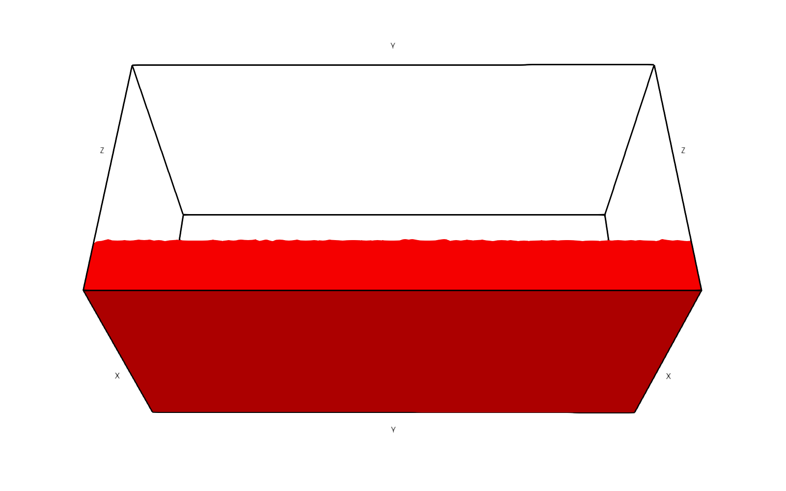
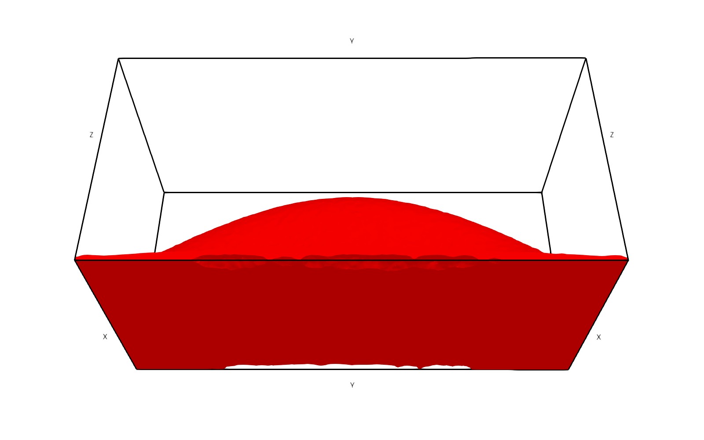
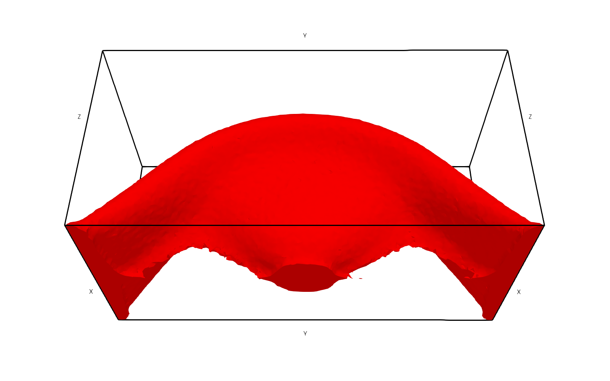

# 算例 4.5 三维桥形优化（初始形状 1）

在本目录运行 `FreeFem++ -nw Main.md`，从第 0 步计算到第 340 步。

## 1. 加载模块

使用 PETSc 求解离散线性系统，使用 Gmsh 网格和 VTK 输出。

~~~freefem
// NBPROC 4
// PRARM -ns -wg

load "TetGen"
load "gmsh"
load "distance"
load "iovtk"
load "PETSc"
load "shell"
verbosity = 0;
~~~

## 2. 参数设置

|变量名|作用|
|:---:|:---:|
|Titer|单次迭代时间步长|
|Tmax|时间步长上限|
|iterMax|最大迭代步数|
|mu, lambda|拉梅常数$\mu,\lambda$|
|weak|非材料区域密度$s$|
|gamma|界面厚度$\gamma$|
|object|输出信息保存文件,.obj|
|ModelMatLabName|需要使用Matlab处理的数据,.m|

~~~freefem
real Tmax = 0.002;
real Titer;
int iterMax = 340;

real mu = 10.0/26.0;
real lambda = 15.0/26.0;
real weak = 6e-3;
real gamma = 0.02;

// 在干净的算例目录首次运行时创建输出目录。
if (isdir("Output") < 0) assert(mkdir("Output") == 0);
if (isdir("figure") < 0) assert(mkdir("figure") == 0);
if (isdir("temp") < 0) assert(mkdir("temp") == 0);
if (isdir("matlab") < 0) assert(mkdir("matlab") == 0);

ofstream object("./Output/Main.obj");

string ModelMatLabName = "matlab/Model2_Shape1.m";
~~~

## 3. 函数和微分算子
$$
H_{\gamma,s} = (1-s)H_{\gamma}+s
$$
$$
H_{\gamma}(x) = 
\begin{cases}
	0, & \phi > \gamma, \\
    \frac{1}{2} - \frac{\phi}{\gamma} + \frac{\phi^2}{2\gamma^2}, & \phi \in (0, \gamma], \\
	\frac{1}{2} - \frac{\phi}{\gamma} - \frac{\phi^2}{2\gamma^2}, & \phi \in [-\gamma, 0], \\  
	1, & \phi < -\gamma.
\end{cases}
$$
~~~freefem
macro HeaviSide(phi)
(
    (phi > gamma) * weak + 
    (0 < phi && phi <= gamma) *
    ( (1-weak) * (0.5-phi/gamma+0.5*phi^2/gamma^2) + weak) +
    (-gamma <= phi && phi <= 0) * 
    ( (1-weak) * (0.5-phi/gamma-0.5*phi^2/gamma^2) + weak) + 
    (phi < -gamma) * 1.0
)//
~~~

指标函数$sign(x)$
~~~freefem
macro sign(x)
(
    (x >= 0) * 1. + (x < 0) * (-1)
)//
~~~

$$
\begin{align*}
\nabla u &= [\partial_x u, \partial_y u, \partial_z u] \\
Du &= [\nabla u_x, \nabla u_y, \nabla u_z] \\
\texttt{div} \ u &= \partial_x u_x + \partial_y u_y + \partial_z u_z
\end{align*}
$$

~~~freefem
macro epsilon(ux, uy, uz) [dx(ux), dy(uy), dz(uz), (dy(ux)+dx(uy))/sqrt(2.), (dz(ux)+dx(uz))/sqrt(2.), (dz(uy)+dy(uz))/sqrt(2.)] //
macro grad(u) [dx(u), dy(u), dz(u)] //
macro Grad(ux, uy, uz) [dx(ux), dy(ux), dz(ux), dx(uy), dy(uy), dz(uy), dx(uz), dy(uz), dz(uz)] //
macro div(ux, uy, uz) ( dx(ux) + dy(uy) + dz(uz) ) //
~~~

计算目标泛函$J(\Omega)$，(Test是右端项计算结果)

形状导数$dJ(\Omega;\theta)$

以及当前区域体积Vol

和$d\texttt{Vol}(\Omega;\theta)$：
~~~freefem
macro GetTestvalue(phi)
(
    sqrt(
    int3d(Th)(
        (sqrt( (dx(phi))^2 + (dy(phi))^2 + (dz(phi))^2 ) - 1.0)^2
    )
    )
)//

macro GetCompliance(Aeueu, Rho)
(
    int3d(Th)(
                Aeueu * Rho
            )
) //

macro GetVol(Rho)
(
    int3d(Th) (Rho)
)//

macro GetdJ(Aeueu, thetax, thetay, thetaz, Rho)
(
    int3d(Th)( 
                Aeueu * ([thetax, thetay, thetaz]' * grad(Rho))
            )
)//

macro GetdV(thetax, thetay, thetaz, Rho)
(
    int3d(Th)( 
                [thetax, thetay, thetaz]' * grad(Rho)
            )
)//
~~~

## 4. 三维网格和有限元空间

`Th004_010.msh` 的实际最大网格尺度约为 $0.03965$。位移和下降方向使用连续向量 P1，水平集 $\phi$ 和密度 $\rho$ 使用 `P1dc3d`。

~~~freefem
mesh3 Th = gmshload3("Th004_010.msh");
real r = 0.1;
macro ForceFace()
(
    (sqrt((x - 0.5)^2 + (y - 1)^2) <= r) &&
    (abs(z) <= 1e-6)
)//

macro DirichletFacey()
(
    ( (abs(y) <= 1e-6) || (abs(y-2) <= 1e-6) ) &&
    (abs(z) <= 0.01)
)//

macro DirichletFacez()
(
    (abs(z) <= 1e-6) &&
    ( (abs(y) <= 0.01) || (abs(y-2) <= 0.01) )
)//

macro NeumannFacex()
(
    (abs(x) <= 1e-6) || (abs(x-1) <= 1e-6)
)//

macro NeumannFacey()
(
    ( (abs(y) <= 1e-6) || (abs(y-2) <= 1e-6) ) &&
    (abs(z) > 0.01)
)//

macro NeumannFacez()
(
    (abs(z-1) <= 1e-6) ||
    ( (abs(z) <= 1e-6)
      && (abs(y) > 0.01) && (abs(y-2) > 0.01)
      && (sqrt((x - 0.5)^2 + (y - 1)^2) > r) )
)//

/* First label: 1--Neumann, 2--Dirichlet, 3--Neumann with force
   Second label: 1--(V_x = 0), 2--(V_y = 0), 3--(V_z = 0) */
macro Labelfunc()
(
    3 * ForceFace +
    22 * DirichletFacey +
    23 * DirichletFacez +
    11 * NeumannFacex +
    12 * NeumannFacey +
    13 * NeumannFacez +
    0
)//
Th = change(Th, flabel = Labelfunc);

savevtk("ThModel2_1.vtu", Th);

fespace P0h(Th, P0);
fespace Uh(Th, [P1, P1, P1]);
fespace Thetah(Th, [P1, P1, P1]);
fespace P1h(Th, P1);
fespace PTh(Th, P1);
fespace Phih(Th, P1dc3d);
fespace Sth = Uh * P1h;

P1h h1 = hTriangle;
real hmax = h1[].max;
real hmin = h1[].min;
object << "Number of the vertices = " << Th.nv << endl;
object << "Number of the Elements = " << Th.nt << endl;
object << "maximal size of a mesh triangle h = " << hmax << endl;
object << "minimal size of a mesh triangle h = " << hmin << endl;
object << "Number of Matrix size1 = " << Uh.ndof << endl;
object << "Number of Matrix size2 = " << Thetah.ndof << endl;
object << "Number od Matrix size3 = " << Phih.ndof << endl;
object.flush;
~~~

## 5. 初始形状和 PDE 求解

### 5.1 初始形状设置

从底部厚度为 0.2 的板构造 `phi0`，用 `distance` 得到连续 P1 距离场，再赋值到 `P1dc3d`。用平滑 Heaviside 函数计算密度并保存第 0 步快照。

~~~freefem
real h = 0.2;
func phi0 = (z >= h) * (z - h) +
            (z < h) * -min(min(x, 1.0-x), min(min(y, 2.0-y), min(z, h - z)));

P1h phiInit;
distance(Th, phi0, phiInit[]);

Phih phi, Rho;
/* P1h Rho; */
phi = phiInit;
Rho = HeaviSide(phi);

savevtk("./figure/phi_0.vtu", Th, phi);
savevtk("./figure/Rho_0.vtu", Th, Rho);
~~~

### 5.2 位移计算

离散系统 $Ku=f$。刚度矩阵按当前密度重新组装，体积积分用 `qfV1`，固定边界载荷向量只组装一次。PETSc 用 CG 求解，另外检查相对残差 $\|Ku-f\|/\|f\|<10^{-8}$。曲线中的柔顺度 $J$ 取为边界载荷对位移所做的功。

~~~freefem
Uh [ux, uy, uz], [vx, vy, vz];

func gx = 0;
func gy = 0;
func gz = -1.0/(pi*r*r);

macro GetComplianceRHS(ux, uy, uz)
(
    int2d(Th, 3) (gx * ux + gy * uy + gz * uz)
)//

varf ElasticityRHS([ux, uy, uz], [vx, vy, vz]) =
int2d(Th, 3) (gx * vx + gy * vy + gz * vz)
+ on(22, 23, ux = 0, uy = 0, uz = 0);

real[int] Elasticityb = ElasticityRHS(0, Uh);

varf ElasticityFastForm([ux, uy, uz], [vx, vy, vz]) =
int3d(Th,qfV=qfV1)(
            2 * mu * Rho * ( epsilon(ux, uy, uz)' * epsilon(vx, vy, vz) )
            + lambda * Rho * div(ux, uy, uz) * div(vx, vy, vz)
        )
+ on(22, 23, ux = 0, uy = 0, uz = 0);

macro ElasticityFast(ux, uy, uz, Rho)
{
    real time0 = clock();
    matrix Am = ElasticityFastForm(Uh, Uh);
    Mat A(Am);
    cout << "Elasticity construct time = " << clock() - time0 << endl;

    time0 = clock();
    set(A, sparams = "-ksp_type cg -ksp_rtol 1e-10 -ksp_converged_reason -ksp_error_if_not_converged");
    real[int] sol = A^-1 * Elasticityb;
    real[int] residualElasticity=Am*sol; residualElasticity-=Elasticityb;
    real relativeElasticityResidual=sqrt(residualElasticity'*residualElasticity)/max(sqrt(Elasticityb'*Elasticityb),1e-30);
    cout<<"ELASTICITY_RESIDUAL "<<relativeElasticityResidual<<endl;cout.flush;
    if (!(relativeElasticityResidual<1e-8)) {cerr<<"VALIDATION_FAILED elasticity true residual"<<endl;exit(92);}

    cout << "Elasticity solve time by KSP = " << clock() - time0 << endl;

    ux[] = sol;

}//
~~~

### 5.3 下降方向计算

体积约束对应分块系统
$$
\begin{bmatrix} A & c_\rho \\ c_\rho^T & \varepsilon \end{bmatrix}
\begin{pmatrix} \theta \\ p \end{pmatrix}
=
\begin{pmatrix} b_\rho \\ 0 \end{pmatrix},\qquad \varepsilon=10^{-10}.
$$
固定矩阵 $A$ 只组装一次。每步用 `qfV1` 组装 $b_\rho$ 和 $c_\rho$，通过两次 CG 求解得到 $z=A^{-1}b_\rho$、$w=A^{-1}c_\rho$，再用 Schur 补算出 $p=c_\rho^Tz/(c_\rho^Tw-\varepsilon)$ 与 $\theta=z-pw$。求解后分别检查两条分块方程的相对残差。

~~~freefem
real lastPressure=0;
Thetah [thetax, thetay, thetaz], [Wx, Wy, Wz];
PTh thetaM;

varf VelocityA([thetax, thetay, thetaz], [Wx, Wy, Wz]) =
int3d(Th)(
            Grad(thetax, thetay, thetaz)' * Grad(Wx, Wy, Wz)
            + ([thetax, thetay, thetaz]' * [Wx, Wy, Wz])
        )
+ on(3, thetax = 0, thetay = 0, thetaz = 0)
+ on(11, thetax = 0)
+ on(12, 22, thetay = 0)
+ on(13, 23, thetaz = 0);
/*+ on(1, 2, 3, thetax = 0, thetay = 0, thetaz = 0);*/

matrix A2m = VelocityA(Thetah, Thetah);

Mat FixedVelocity(A2m);
set(FixedVelocity, sparams="-ksp_type cg -ksp_rtol 1e-10 -ksp_converged_reason -ksp_error_if_not_converged");
macro VelocityFast(thetax, thetay, thetaz, Aeueu, Rho)
{
    real stageClock=clock();
    varf cFast([thetax,thetay,thetaz],[Wx,Wy,Wz]) =
    int3d(Th,qfV=qfV1)([Wx,Wy,Wz]'*grad(Rho))
    + on(3,thetax=0,thetay=0,thetaz=0)
    + on(11,thetax=0) + on(12,22,thetay=0) + on(13,23,thetaz=0);
    varf bFast([thetax,thetay,thetaz],[Wx,Wy,Wz]) =
    -int3d(Th,qfV=qfV1)(Aeueu*([Wx,Wy,Wz]'*grad(Rho)))
    + on(3,thetax=0,thetay=0,thetaz=0)
    + on(11,thetax=0) + on(12,22,thetay=0) + on(13,23,thetaz=0);
    real[int] b=bFast(0,Thetah), c=cFast(0,Thetah);
    real[int] z=FixedVelocity^-1*b;
    real[int] w=FixedVelocity^-1*c;
    real denominator=c'*w-1e-10;
    if (!(abs(denominator)>1e-20)) {cerr<<"VALIDATION_FAILED Schur denominator"<<endl;exit(92);}
    real multiplier=(c'*z)/denominator;
    real[int] sol=z-multiplier*w;
    real[int] rr=A2m*sol;
    rr+=multiplier*c;rr-=b;
    real momentumResidual=sqrt(rr'*rr)/max(sqrt(b'*b),1e-30);
    real constraintResidual=abs(c'*sol+1e-10*multiplier)/max(abs(c'*z),1e-30);
    cout<<"VELOCITY_RESIDUAL "<<momentumResidual<<" "<<constraintResidual<<endl;
    cout.flush;
    if (!(momentumResidual<1e-8 && constraintResidual<1e-8)) {cerr<<"VALIDATION_FAILED original velocity block residual"<<endl;exit(92);}
    thetax[]=sol;
    lastPressure=multiplier;
    cout<<"Velocity fast time = "<<clock()-stageClock<<endl;
}//
~~~

### 5.4 形状更新

采用 dual-P^1 DG方法求解：
$$
\phi_t + \theta \cdot \nabla \phi = 0
$$
在每次形状更新中取 $dt=T_{\mathrm{iter}}/5$：
$$
\begin{align*}
& \int_D \frac{\phi^{n+1}-\phi^n}{dt} v dx + \int_D v \theta \cdot \nabla \phi dx - \sum_{K \in \mathcal{T}_h} \sum_{E \subset \partial K} \int_E \frac{|\theta \cdot n|-\theta \cdot n}{2}[\phi^{n+1}] v ds \\
= & \sum_{E \subset \partial D} \int_{E \bigcap \lbrace \theta \cdot n < 0 \rbrace} |\theta \cdot n | \phi^{n+1} v ds
\end{align*}
$$
代码中下降方向在相应边界满足零法向或零分量约束，因此外边界入流项不再单独装配。

体积项用 `qfV2` 积分。DG 质量矩阵全程复用，每个外层迭代组装一次输运矩阵，各子步用 GMRES 求解。

~~~freefem
macro nn()
(
    N.x * thetax + N.y * thetay + N.z * thetaz
)//

varf UnitMass(u,v)=int3d(Th,qfV=qfV2)(u*v);
matrix UnitMassLocal=UnitMass(Phih,Phih);
Mat UnitMassPETSc(UnitMassLocal);
macro LFDGFast(phiOutput, phiInput, thetax, thetay, thetaz, Tsum)
{
    real t = 0.;
    real dt = Tsum / 5.;

    Phih u, v, Rhotest;
    P1h OutRho;

    varf Adual(u, v) =
    int3d(Th,qfV=qfV2) ( (u / dt + ([thetax, thetay, thetaz]' * grad(u))) * v )
    - intallfaces(Th) (
                        (nElementonB - 1) * v
                        * (0.5 * abs(nn) - nn / 2) * jump(u)
                    );

    real time0 = clock();

    matrix Am = Adual(Phih, Phih);
    Mat A(Am);
    set(A, sparams = "-ksp_type gmres -ksp_rtol 1e-10 -ksp_converged_reason -ksp_error_if_not_converged");
    cout << "DG construct time = " << clock() - time0 << endl;

    for (t = 0; t < Tsum; t += dt)
    {
        time0 = clock();
        v[] = UnitMassPETSc * phiInput[];
        v[] /= dt;
        phiOutput[] = A^-1 * v[];
        phiInput = phiOutput;
        cout << "DG solve time = " << clock() - time0 << endl;
    }
}//
~~~

## 6. 迭代求解及结果输出

### 6.1 重初始化和诊断

`distance` 将当前水平集重初始化到连续 P1 空间，再赋回 `P1dc3d`。CSV 中 `tv` 是输运后、重初始化前的梯度偏差，`v_before` 是上一迭代步体积，`v_after_transport` 是本步输运后、重初始化前的体积。

~~~freefem
macro OutPutData(i, compliance, vol, obj)
{
    if (i == 0)
    {
        obj << "Initial Condition: " << endl;
        obj << "Initial Compliance = " << compliance[i] << endl;
        obj << "Initial Vol = " << vol[i] << endl;
    }
    else
    {
        obj << i << "-th iteration: " << endl;
        obj << "Compliance = " << compliance[i] << ";   diff = " << compliance[i] - compliance[i-1] << endl;
        obj << "Vol = " << vol[i] << ";   diff = " << vol[i] - vol[0] << endl;
    }
    obj.flush;
}//

macro RedistanceConvert(phiInput)
{
    P1h phiRe;
    distance(Th, phiInput, phiRe[]);
    phiInput = phiRe;
}//

Uh [uxnew, uynew, uznew];
Phih phitest, phinew, Rhonew;
P0h Aeueu;
real[int] compliance(iterMax + 1);
real[int] Vol(iterMax + 1);
real compliancenew, Volnew;

int iter = 0;
macro CheckFinite(value, stage)
{
    if (!(abs(value) <= 1e308))
    {
        cerr << "NONFINITE_STATE " << stage << " step=" << iter << " value=" << value << endl;
        exit(91);
    }
}//
ofstream history("temp/history.csv");
history.precision(16);
history << "iter,volume,compliance,Titer,reinit,tv,v_before,v_after_transport" << endl;
~~~

### 6.2 第 0 步

在初始形状上计算位移、下降方向、体积和柔顺度。

~~~freefem
cout << "Time Begin "  << endl;
real time = clock();
ElasticityFast(ux, uy, uz, Rho);
Aeueu = (2 * mu *  epsilon(ux, uy, uz)' * epsilon(ux, uy, uz)
                   + lambda * div(ux, uy, uz) * div(ux, uy, uz) );
cout << "Elasticity time = " << clock() - time << endl;

time = clock();
VelocityFast(thetax, thetay, thetaz, Aeueu, Rho);
cout << "Velocity time = " << clock() - time << endl;
savevtk("Vh.vtu", Th, [thetax, thetay, thetaz]);

cout << endl;
object << endl;
compliance[iter] = GetComplianceRHS(ux, uy, uz);
Vol[iter] = GetVol(Rho);
CheckFinite(Vol[iter], "volume");
CheckFinite(compliance[iter], "compliance");
history << iter << "," << Vol[iter] << "," << compliance[iter] << ",0,0,0," << Vol[iter] << "," << Vol[iter] << endl;
history.flush;
OutPutData(iter, compliance, Vol, object);

time = clock();
~~~

### 6.3 主循环

时间步长 $T_{\mathrm{iter}}=\min(0.002,0.4h_{\min}/\max|\theta|)$。每步先输运水平集，每 8 步执行一次重初始化，然后更新密度、位移和下降方向。输出第 60 步和最终步的 VTU。

~~~freefem
int Redis = 0;
while ( iter < iterMax )
{
    thetaM = (thetax * thetax + thetay * thetay + thetaz * thetaz)^(0.5);
    Titer = min(Tmax, 0.4*hmin/thetaM[].max);

    iter++;
    CheckFinite(Titer, "Titer");
    if (!(Titer > 0)) { cerr << "INVALID_TIME_STEP step=" << iter << " value=" << Titer << endl; exit(91); }
    Redis++;
    cout << endl;
    cout << "iter = " << iter << endl;
    cout.flush;
    object << endl;
    object << "iter = " << iter << endl;
    object << "Titer = " << Titer << endl;

    phitest = phi;
    real time0 = clock();
    LFDGFast(phi, phitest, thetax, thetay, thetaz, Titer);

    Phih transportedDensity = HeaviSide(phi);
    real transportedVolume = GetVol(transportedDensity);
    CheckFinite(transportedVolume, "transport volume");
    real tv = GetTestvalue(phi);
    CheckFinite(tv, "transport gradient");
    cout << "|| |grad(phi)| -1 || = " << tv << endl;
    // 固定每 8 步用 distance 重新初始化水平集。
    if (Redis >= 8)
    {
        RedistanceConvert(phi);
        CheckFinite(GetTestvalue(phi), "redistance gradient");
        cout << "Redistance End!" << endl;
        cout << "Redistance || |grad(phi)| -1 || = " << GetTestvalue(phi) << endl;
        Redis = 0;
    }
    Rho = HeaviSide(phi);
    cout << "LFDG time = " << clock() - time0 << endl;

    time0 = clock();
    ElasticityFast(ux, uy, uz, Rho);
    Aeueu = (2 * mu *  epsilon(ux, uy, uz)' * epsilon(ux, uy, uz)
                   + lambda * div(ux, uy, uz) * div(ux, uy, uz) );
    cout << "Elasticity time = " << clock() - time0 << endl;

    time0 = clock();
    VelocityFast(thetax, thetay, thetaz, Aeueu, Rho);
    cout << "Velocity time = " << clock() - time0 << endl;

    object << "Test Compliance = " << GetCompliance(Aeueu, Rho) << endl;
    compliance[iter] = GetComplianceRHS(ux, uy, uz);
    Vol[iter] = GetVol(Rho);
    CheckFinite(Vol[iter], "volume");
    CheckFinite(compliance[iter], "compliance");
    history << iter << "," << Vol[iter] << "," << compliance[iter] << "," << Titer << "," << (Redis == 0) << "," << tv << "," << Vol[iter-1] << "," << transportedVolume << endl;
    history.flush;

    OutPutData(iter, compliance, Vol, object);

    if (iter == 60 || iter == iterMax)
    {
        string filename = "./figure/phi_"+iter+".vtu";
        savevtk(filename, Th, phi);
        filename = "./figure/Rho_"+iter+".vtu";
        savevtk(filename, Th, Rho);
    }

    object << "iter Time = " << clock() - time << endl;
    object.flush;
    cout << "iter Time = " << clock() - time << endl;
    time = clock();
}
~~~

### 6.4 MATLAB 数据

`Num` 包含初始状态，MATLAB 数组下标 $i+1$ 对应第 $i$ 步。随仓库提供的 MATLAB 数据含第 0–340 步的体积和柔顺度，重新运行会另在 `temp/history.csv` 写出逐步诊断。

~~~freefem
ofstream OutMatlab(ModelMatLabName);
OutMatlab << "Num = " << iter + 1 << endl;
for (int i = 0; i <= iter; i++)
{
    OutMatlab << "Volume(" << i+1 << ") = " << Vol[i] << "; ";
    OutMatlab << "compliance(" << i+1 << ") = " << compliance[i] << ";"<<endl;
}
~~~

## 7. 形状演化

| 步数 | 形状 |
|:---:|:---:|
| 0 |  |
| 60 |  |
| 340 |  |

[体积曲线](../Model2_Matlab/M4E2_volume.pdf) · [柔顺度曲线](../Model2_Matlab/M4E2_compliance.pdf)
